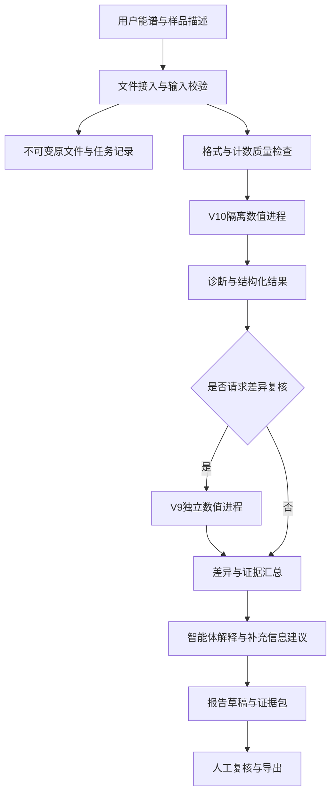

# 面向未知测量条件XRF谱的智能体构建方案

版本：1.0；日期：2026-10-30。状态：供实施确认的完整方案，本次未创建或修改智能体运行能力。

## 1. 要解决的问题与交付范围

行业入口是客户只提供能谱和少量样品描述，却要求说明“有哪些元素、含量大致多少”。测量仪器、距离、容器、空气路径、能量刻度和基体组成可能缺失。系统应完成可追溯的候选元素识别与条件性定量，指出哪些结论缺乏足够证据，并把最有价值的补充信息交给用户。

首版收束为X射线荧光谱。样品场景围绕现有数据覆盖的合金、硅酸盐／土壤和过渡金属氧化物，不承诺覆盖所有矿石或所有核分析技术。32个目标元素与模型实际输出一致，不能临时通过提示词增加目标元素。

首版交付包括：本地数值服务、智能体工具接口、文件接入与校验、任务状态、报告与证据导出、模型注册与回归检查。先形成端到端可运行版本，再扩展复杂界面。大语言模型负责组织任务、解释证据和生成报告；含量来自冻结的数值程序。

当前可立即接入的输入是2048道合成原始计数JSON。真实`.pu`等格式的解析以及实测谱能力属于后续单独验收的接入阶段，不能给实测谱伪造`synthetic=true`。不预设未知物理条件一定可以唯一反演；同一谱可能存在多个近似解释。

## 2. 模型角色与选择依据

| 项目 | V10 | V9 |
|---|---|---|
| 方案中角色 | 默认主推断数值后端 | 按需差异复核后端 |
| 当前版本 | 完整分类与定量增量候选 | 联合强度定量＋谱支持诊断 |
| 主要用途 | 增强新增基体与测量条件的覆盖 | 暴露与历史方案的差异，保留旧域参考 |
| 不能据此推断 | 对所有新仪器都有效 | 谱支持范围内就一定准确 |

本机历史默认指针仍为V9；本方案推荐未来智能体使用V10主后端，不在本次上传中擅自切换现有配置。

依据最近同名单2,223条合成回归谱，选取以下分组指标。它们已经参与实验观察，不能再称为未见盲测。新域2,000条来自100个父族的浓度及条件组合，不是2,000个独立样品。

| 分组／模型 | 正含量≤5%达标率 | 正含量≤10%达标率 | 正含量MAPE | 全元素MAE（含量百分点） | 零含量误报数 | ≥10 ppm漏报数 |
|---|---:|---:|---:|---:|---:|---:|
| 旧域223／V9 | 27.231% | 39.737% | 59.443% | 0.095258 | 27 | 1,130 |
| 旧域223／V10 | 24.296% | 38.065% | 54.429% | 0.099895 | 18 | 995 |
| 新域2,000／V9 | 2.767% | 4.854% | 11,868.169% | 1.961891 | 4,013 | 19,216 |
| 新域2,000／V10 | 8.614% | 15.316% | 537.598% | 0.547661 | 457 | 11,030 |

误报／漏报按原评分脚本的10 ppm报告阈值定义；它不是仪器检出限。正含量MAPE不包含零真值，接近零的含量会显著放大相对误差。全元素MAE单位为质量百分含量的百分点，不能把0.547661写成0.547661%的相对误差。

结论是V10在本批新域指标明显改善，同时仍有旧域定量退步。两版都未达到“相对误差≤5%”的总体目标，均未具备真实仪器高精度报告资格。智能体上线演示不能被表述为定量标准已经通过。

V9不能作为真值。两版不一致是复核线索；两版一致也可能共同偏误。首版不做自动平均、逐元素择优或模型投票，不把V9诊断直接硬门控到V10结果上。

## 3. 系统结构与职责边界



实现上分为五层：文件／任务层、解析与质量层、冻结数值层、智能体编排层、报告与审计层。数值层保持普通Python子进程接口，可由后续选定的工具协议包装，不把某家平台写进模型内部。首版本地运行，输入原谱和机密资料无需默认上传外部服务。

模型调用通过进程隔离解决历史模块重名问题。模型注册表固定版本、入口、依赖、包哈希、元素顺序、预处理标识和适用范围。提示词、工具契约与数值版本分别编号，报告记录三者组合。

## 4. 输入契约与实测谱接入

用户入口接受文件及可选描述：样品类别、是否粉末／块体、已知仪器与测量时间、是否有能量轴、是否做过平滑或扣背景。用户不知道的字段保留缺失，不补猜测数值。文字描述带来源，不能静默当作已校准事实。

现有模型输入契约必须严格保持：

```json
{
  "axis": "channel",
  "signal_unit": "counts",
  "synthetic": true,
  "x": [0, 1, 2],
  "counts": [0, 3, 8]
}
```

上例只展示字段形状，实际`x`必须为0至2047，`counts`长度也必须为2048。计数为有限、非负整数且总量大于0；禁止附带组成、种子和模拟条件。模型工具只接收经过校验的文件引用，不允许LLM自行构造缺失谱。

真实文件接入按以下顺序完成：

1. 找到格式说明与样例，读取原始通道、计数和文件中实际存在的元数据，逐项记录来源。
2. 与原仪器软件导出进行逐道对照，证明解析结果、通道起点和计数单位一致。
3. 不同道数、已扣背景、率谱、平滑谱分别处理；未经验证时返回“不支持该输入”，不为凑2048道随意插值。
4. 若需重分箱，使用明确的计数守恒与能窗规则，单独锁定适配器版本，验证是否需要配套重训。
5. 对同型号不同设备、已知成分标样和未知条件样本建立实测确认，验证后再扩展模型入口的能力声明。

用户文档、谱文件中的文字和检索资料都只作为数据或证据，不能覆盖工具权限、改变模型或跳过校验。

## 5. 工具接口设计

以下是拟实施的工具名，不表示本次已实现。所有工具返回统一字段`status`、`job_id`、`input_sha256`、`artifact_refs`、`warnings`、`error_code`。文件引用限定在当前任务目录，禁止任意路径读取。

| 工具 | 输入 | 输出与验收要点 |
|---|---|---|
| `inspect_spectrum` | 任务文件引用、可选格式 | 格式、道数、单位、总计数、原文件哈希、元数据来源；不估计含量 |
| `validate_model_input` | 解析产物、模型版本 | 校验结果和标准化文件引用；不改变原文件 |
| `infer_v10` | 已校验文件引用 | 32元素含量、分类概率、刻度诊断、版本与哈希；按冻结入口执行 |
| `infer_v9` | 同一已校验文件引用 | 32元素含量、现有谱支持诊断、版本与哈希；独立进程 |
| `compare_predictions` | 两个数值结果引用 | 同元素单位对齐后的差值、报出状态差异、诊断摘要；不挑选“正确答案” |
| `assemble_evidence` | 原始与派生结果引用 | 证据清单、适用范围、缺失信息、人工复核项 |
| `render_report` | 经校验的报告结构、证据引用 | 报告草稿、JSON和可选PDF；所有数值可回溯 |
| `get_job_status`／`cancel_job` | 任务编号 | 阶段、已处理数量、耗时或取消状态；停止子进程，保留已完成证据 |

工具失败必须有明确原因，如`UNSUPPORTED_FORMAT`、`INVALID_COUNTS`、`INTEGRITY_FAILED`、`TIMEOUT`、`NUMERICAL_FAILURE`。失败时不让LLM编造备用含量。原文件只读保存；结果新建，禁止覆盖已有输出。包校验失败必须停止执行，不能自动刷新哈希“修复”。

## 6. 谱处理与数值运行规则

第一版直接使用两版各自冻结的预处理链。不能在智能体外侧随意增加平滑、SNIP扣背景、峰宽修正或归一化后再把谱送进模型，否则训练与推理分布可能不同。

现有刻度与响应盲估结果属于模型解释假设，不是恢复了真实仪器参数。候选间的拟合差距和谱支持信息是诊断线索，不等同统计置信区间。若增加残差、谱线组、背景或逃逸峰分解展示，应从实际计算过程导出，不能让语言模型补画或补数。

未知基体和几何条件引起的吸收、增强与能量依赖响应不能靠文字说明消除。未来修改这些环节，必须同时固定输入处理、训练特征及推理实现，并完成原域与新域保护实验。

报告不强制把32元素总和归一化为100%，也不把差额自动填成氧。分元素预测的闭合异常应作为诊断，不能在未经验证的后处理中掩盖。

## 7. 分类、定量与可信度联合呈现

首先分别记录“是否报出”和“报出的含量”。0输出使用“本模型未报出”，不能写“含量为零”或“确定不存在”。分类概率只代表当前分类器输出，未经独立校准，不能写成“该含量有90%准确率”。

可信度展示分清三类信息：输入有效性、谱学／响应诊断、跨版本差异。首版按事实呈现，不拟造综合置信百分比；“未触发告警”也不等于正确。V9的支持诊断来自自己的训练表征，对V10仅供参考。

如后续需要自动分级或复核触发阈值，应只使用训练／校准数据预先确定，在未参与开发的数据上验证，不能在既有2,223条观察样本中继续搜索。极端样本可单列诊断，不能从最终测试分母中悄悄删除。

## 8. 智能体对话与报告流程

用户上传后，先显示任务阶段与输入摘要。可直接运行的合成谱先完成主推断；缺失条件不阻塞所有工作。只有信息会决定输入是否受支持、单位如何解释或是否能出正式结论时，才提出少量关键问题。

V9差异复核由用户请求、预先登记的业务规则或人工复核触发，不默认每条都运行两套昂贵算法。未完成速度测量前不承诺实时返回；批任务异步运行并提供状态。

客户主报告保持简洁：样品／任务信息、候选元素与估计含量、单位、必须说明的限制、需要补充的信息。技术附件提供输入哈希、解析器版本、数值入口与包哈希、刻度诊断、两版差异、计算时间和证据文件索引。没有校准证据时不伪造不确定度或检出限。

建议结果表字段：

| 字段 | 规则 |
|---|---|
| 元素 | 仅使用实际输出的32元素集合 |
| 模型报出状态 | 报出／未报出，不能等同真实存在／不存在 |
| 估计含量与单位 | 来自V10原始输出；ppm与%由工具换算 |
| 复核信息 | 相关诊断或V9差异，若未运行则明确注明 |
| 适用性说明 | 合成研究结果／实测能力是否已经验证 |

当前全部报告以“研究分析草稿”导出，`formal_report_eligible=false`和`hardware_validated=false`保留到真正完成对应验证。可以演示完整报告流程，但不能宣称已满足行业≤5%误差验收。

## 9. 知识库与资料使用

知识库服务于解释XRF谱线、基体效应、响应与校正方法，不代替数值模型。优先收录可追溯的数据库、仪器说明书和原始论文，记录标题、作者／机构、年份、版本、页码或章节、来源链接及适用对象。

将“文献明确结论”“本项目实验结果”“当前推断”分开。检索到某种校正法，不代表已在本项目验证。仪器规格与未知客户设备的实际参数不能直接画等号。未取得正文的论文不能据摘要编造实验细节。

禁止把训练标签、加密封存标签、解密凭据及私人聊天作为面向用户的检索库。模型工具没有访问这些目录的权限；测试评分器与推理服务隔离。

## 10. 数据、任务与模型管理

建议运行目录：

```text
agent-workspace/
  registry/               # 模型、工具契约和提示词版本
  jobs/<job_id>/
    input/                # 不可变原文件与输入来源记录
    parsed/               # 校验及解析结果
    inference/            # 数值输出、诊断、版本哈希
    report/               # 报告草稿和结构化结果
    audit/                # 工具调用、时间、失败原因
  models/                 # 冻结的V9/V10运行包
```

原谱、解析结果和报告通过哈希关联。去重缓存键至少包括输入哈希、模型包哈希和适配器版本。输入相同而模型版本不同不能复用同一缓存。

临时文件使用任务专属目录，成功或失败后均清理。长期证据与可再生缓存分开；删除原谱或模型前核对备份和依赖。日志只记录必要诊断，避免完整口令、令牌、私人路径及未经授权的原谱内容。

并发数按测得的单任务峰值内存和耗时设置，先完成单进程测量再有限并发；不要按CPU核数直接启动同等数量拟合进程。为长任务提供取消、超时和失败重试，重试不得悄悄换模型。

## 11. 验收标准与评分方法

工程验收：模型包完整性通过；源码编译／语法检查通过；固定样例回归通过；V6独立路径不可访问时V9/V10仍运行；迁移后推断一致；异常输入被拒绝；报告数值与JSON一致；临时文件得到清理；任务取消和超时可恢复。

智能体验收：有数值证据才输出含量；不虚构仪器、能量刻度、校正方法或测量时间；文档注入不改变工具规则；不把未报出写成真实零含量；引用可定位；失败不生成伪报告；不能读取封存标签；对话多轮仍引用正确任务与模型版本。

科学评估应同时列出：

1. 真值>0的≤5%及≤10%相对误差达标率。
2. 正含量MAPE、中位相对误差及按含量段的误差；零真值不参与相对误差分母。
3. 全部样本×全部目标元素的MAE与RMSE，单位为含量百分点，包含零真值。
4. 按明确报告阈值计算的零含量误报率、正含量漏报率，附计数及分母。
5. 元素、基体、条件、浓度段及父族分组结果；整体指标之外保护旧域表现。
6. 未报出项仍进入漏报和含量误差计算，不得只统计成功报出的元素。

“全测试数据的平均误差”必须指定上述哪一种，不能对零真值计算普通相对误差。10 ppm仅沿用对照定义，不作为真实检出限。

独立合成确认按父族与条件划分，不把同配方不同噪声分到两边。真实确认使用成分可追溯的标样、独立样品、不同测量条件及不同设备，冻结模型后盲评分。重复测量用于评估测量变异，不能当成等量独立样品提高统计把握。

正式科学放行前，应根据业务需要预先确定目标元素、含量范围、允许误差、误报／漏报预算和统计置信要求；本方案不虚设一个尚未被验证的通过率。已观察的封存集不能再恢复为独立盲测集。

## 12. 最小实施顺序与停止条件

| 阶段 | 实施内容 | 完成标准 | 未通过时怎么办 |
|---|---|---|---|
| M0：冻结后端 | V9/V10运行包、依赖、入口、哈希与回归 | 独立目录可运行且迁移前后数值一致 | 修复路径／环境，不改权重来掩盖问题 |
| M1：数值工具 | 输入校验、隔离调用、状态、取消、错误码 | 一条合成谱到结构化输出全程可追溯 | 保留普通CLI，不接LLM自动调度 |
| M2：最小智能体 | 固定工作流、工具调用、报告草稿 | 能正确解释成功、拒绝和失败案例 | 修复编排与契约，不扩工具规模 |
| M3：回归与展示 | 固定对话测试、数值核对、包部署 | 工程与智能体验收通过 | 只演示已通过能力 |
| M4：实测接入 | 格式验证、标样、跨设备盲确认 | 达到预先登记的对应业务标准 | 维持研究草稿，不能升级准确度声明 |

M0本次随模型发布完成；M1—M4是待实施工作，不把方案描述写成既成事实。第一阶段不再扩量、搜索门控或逐元素试错，优先完成可调用、可解释、可核查的闭环。

开发用时只有在确认宿主平台、现有可复用代码及实测格式后才能可靠估计。应先计时跑通M1，再给后续排期，避免把未知拟合耗时写成保证。

## 13. 建议分工

| 负责人 | 主任务 | 交付物 |
|---|---|---|
| A（项目负责人） | 冻结范围、主后端选择、模型注册、数值回归与最终审查 | 模型包、固定评分表、放行记录 |
| B | 文件解析、输入契约、数值进程封装、资源与错误处理 | 解析器、工具接口、异常测试 |
| C | 证据整理、分组评估、实测样品与条件记录 | 证据清单、独立确认方案、评估报告 |
| D | 智能体编排、报告模板、任务界面及交互测试 | 工作流、报告草稿、端到端演示 |

这是下一阶段建议分工，不改变既有数据生产责任，也不代表已向队友发送任务。核心契约由A与B共同冻结，数值与报告至少由另一位成员复核后合并。

## 14. 最终交付清单

- V9、V10冻结运行包、依赖版本、文件哈希、来源与迁移说明。
- 输入／输出及工具JSON契约，模型注册表与支持范围。
- 数值工具服务、智能体工作流、任务状态与取消机制。
- 用户报告模板、机器可读JSON、证据包及版本索引。
- 固定工程／交互回归集及失败案例；科学测试集分组与使用状态登记。
- 实测适配与独立确认记录；没有通过时明确保留研究标记。
- 安装运行、资源配置、升级回滚和数据清理说明。

本方案的优先级是：先让V10数值能力被稳定调用，再让用户能看懂结果与限制，随后用独立实测证明适用范围。智能体本身不增加谱的信息量；它的价值是减少遗漏、误用和不可追溯的分析过程。
