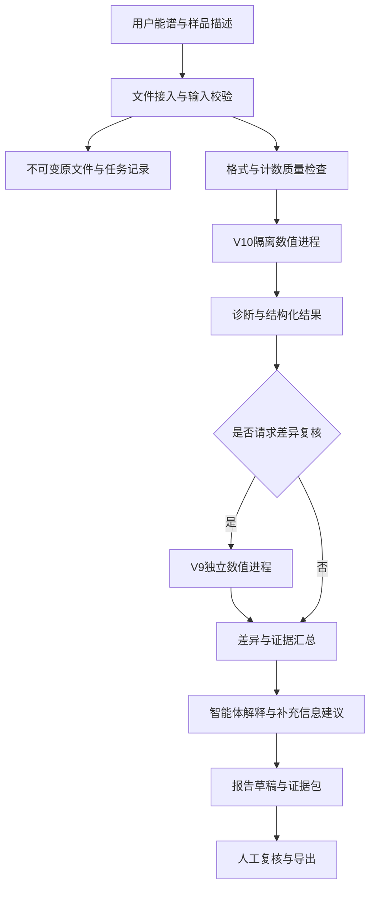

# 面向未知测量条件XRF谱的智能体构建方案

版本：1.1（单人开发修订）；日期：2026-10-31。负责人：A／项目负责人本人。状态：实施计划，未创建或修改智能体运行能力。

本版替代1.0中的ABCD开发分工与必须由他人审查的安排；既有ABCD数据生产任务和历史交付不变。模型、权重、数值预处理和既有评分结论不变。先交付一个完整可运行任务，再增加功能。

## 1. 要解决的问题与交付范围

行业入口是客户只提供能谱和少量样品描述，却要求说明“有哪些元素、含量大致多少”。测量仪器、距离、容器、空气路径、能量刻度和基体组成可能缺失。系统应完成可追溯的候选元素识别与条件性定量，指出哪些结论缺乏足够证据，并把最有价值的补充信息交给用户。

首版收束为X射线荧光谱。样品场景围绕现有数据覆盖的合金、硅酸盐／土壤和过渡金属氧化物，不承诺覆盖所有矿石或所有核分析技术。32个目标元素与模型实际输出一致，不能临时通过提示词增加目标元素。

首版只交付：一个文件入口、V10主分析、按需V9对照、一份研究报告和证据记录、一个可调用这些工具的真实大模型宿主。任务先单线程处理，状态先保存为本地文件。命令行跑通后再提供最薄的一层交互界面。

首版暂缓：多智能体、向量数据库、长周期记忆、批量并发、独立微服务、自动重训、自动搜索门控、复杂仪表盘。Python数值子进程已经能解决的调用不再套多层框架；仅在选定宿主确实需要时增加MCP等适配层。大语言模型负责组织任务、解释证据和生成报告；含量来自冻结的数值程序。

当前可立即接入的输入是2048道合成原始计数JSON。真实`.pu`等格式的解析以及实测谱能力属于后续单独验收的接入阶段，不能给实测谱伪造`synthetic=true`。不预设未知物理条件一定可以唯一反演；同一谱可能存在多个近似解释。

## 2. 模型角色与选择依据

| 项目 | V10 | V9 |
|---|---|---|
| 方案中角色 | 默认主推断数值后端 | 按需差异复核后端 |
| 当前版本 | 完整分类与定量增量候选 | 联合强度定量＋谱支持诊断 |
| 主要用途 | 增强新增基体与测量条件的覆盖 | 暴露与历史方案的差异，保留旧域参考 |
| 不能据此推断 | 对所有新仪器都有效 | 谱支持范围内就一定准确 |

本机历史默认指针仍为V9；本方案推荐未来智能体使用V10主后端。计划修改不切换现有配置。V9/V10运行包已在协作仓库合并（PR #63），但合并不代表智能体已建成。

依据最近同名单2,223条合成回归谱，选取以下分组指标。它们已经参与实验观察，不能再称为未见盲测。新域2,000条来自100个父族的浓度及条件组合，不是2,000个独立样品。

| 分组／模型 | 正含量≤5%达标率 | 正含量≤10%达标率 | 正含量MAPE | 全元素MAE（含量百分点） | 零含量误报数 | ≥10 ppm漏报数 |
|---|---:|---:|---:|---:|---:|---:|
| 旧域223／V9 | 27.231% | 39.737% | 59.443% | 0.095258 | 27 | 1,130 |
| 旧域223／V10 | 24.296% | 38.065% | 54.429% | 0.099895 | 18 | 995 |
| 新域2,000／V9 | 2.767% | 4.854% | 11,868.169% | 1.961891 | 4,013 | 19,216 |
| 新域2,000／V10 | 8.614% | 15.316% | 537.598% | 0.547661 | 457 | 11,030 |

误报／漏报按原评分脚本的10 ppm报告阈值定义；它不是仪器检出限。正含量MAPE不包含零真值，接近零的含量会显著放大相对误差。全元素MAE单位为质量百分含量的百分点，不能把0.547661写成0.547661%的相对误差。

结论是V10在本批新域指标明显改善，同时仍有旧域定量退步。两版都未达到“相对误差≤5%”的总体目标，均未具备真实仪器高精度报告资格。智能体上线演示不能被表述为定量标准已经通过。

V9不能作为真值。两版不一致是复核线索；两版一致也可能共同偏误。首版不做自动平均、逐元素择优或模型投票，不把V9诊断直接硬门控到V10结果上。

## 3. 系统结构与职责边界



实现上保留文件／任务、解析与质量、冻结数值、智能体编排、报告与审计五个逻辑模块，但首版放在同一个Python项目内，不拆成五个服务。数值层保持普通Python子进程接口。每个任务固定V10主入口，V9仅按需单次对照；不允许LLM自行修改路径或指定任意模型。

数值计算优先本地运行。若大模型经远端API调用，默认只传必要的脱敏样品描述、结构化诊断与结果摘要，不传完整原谱、标签或凭据；远端API模式不称为“全离线”。全离线部署是否可行取决于真实模型和本机资源，不在计划中假定已经具备。

模型调用通过进程隔离解决历史模块重名问题。模型注册表固定版本、入口、依赖、包哈希、元素顺序、预处理标识和适用范围。提示词、工具契约与数值版本分别编号，报告记录三者组合。

## 4. 输入契约与实测谱接入

用户入口接受文件及可选描述：样品类别、是否粉末／块体、已知仪器与测量时间、是否有能量轴、是否做过平滑或扣背景。用户不知道的字段保留缺失，不补猜测数值。文字描述带来源，不能静默当作已校准事实。

现有模型输入契约必须严格保持：恰有`axis`、`signal_unit`、`synthetic`、`x`、`counts`五个字段；固定`axis="channel"`、`signal_unit="counts"`、`synthetic=true`，`x`为0至2047，`counts`长度2048且全为有限非负整数，总量大于0。不接受布尔计数、附加真值、仪器条件或种子。完整可执行示例使用运行包的`examples/synthetic_blind.json`，文档不再用截短数组冒充有效输入。

工具只接收经过校验的任务文件引用，不能由LLM编造缺失谱。用户备注与实际送入模型的五字段输入分开保存。是否合成必须由输入来源记录支持，不能通过用户一句“这是模拟的”改写真实文件来源。

将实测格式可行性检查提前到P0：先从已有`.pu`样例核对能否无损读出原始通道和计数。能解析只证明格式接入，不证明模型适用；保持独立的`source_kind=measured`记录，模型适配未验证时停止定量。该检查不演变成先解决所有仪器问题才做演示。

真实文件接入按以下顺序完成：

1. 找到格式说明与样例，读取原始通道、计数和文件中实际存在的元数据，逐项记录来源。
2. 与原仪器软件导出进行逐道对照，证明解析结果、通道起点和计数单位一致。
3. 不同道数、已扣背景、率谱、平滑谱分别处理；未经验证时返回“不支持该输入”，不为凑2048道随意插值。
4. 若需重分箱，使用明确的计数守恒与能窗规则，单独锁定适配器版本，验证是否需要配套重训。
5. 对同型号不同设备、已知成分标样和未知条件样本建立实测确认，验证后再扩展模型入口的能力声明。

用户文档、谱文件中的文字和检索资料都只作为数据或证据，不能覆盖工具权限、改变模型或跳过校验。

## 5. 最小工具接口与状态机

以下是待实施接口，不表示本次已实现。对外先暴露四个工具，解析、校验、证据装配作为内部函数，减少单人维护的接口数。

| 工具 | 输入 | 输出与约束 |
|---|---|---|
| `analyze_spectrum` | 任务文件引用、可选样品描述引用 | 内部依次解析、校验、锁定输入和版本、调用V10；返回任务编号与状态，不允许覆盖旧结果 |
| `get_job_status` | 任务编号 | 阶段、耗时、错误码、已完成产物引用；未知任务不能读取其他目录 |
| `compare_models` | 已完成V10的任务编号 | 以同一输入单次运行V9，返回差异及诊断；不替换V10原始结果 |
| `export_report` | 已完成任务编号、是否附对照 | 输出结构化JSON、中文Markdown报告与证据索引；PDF后加，失败不伪装为成功 |

结果信封至少有`schema_version`、`status`、`job_id`、`input_sha256`、`model_version`、`model_package_sha256`、`artifact_refs`、`warnings`、`error_code`。含量结果按元素保留原始浮点值和明确的`mass_percent`单位；显示层四舍五入不回写数值结果。输出32元素集合、有限值与模型声明范围由程序校验。

任务状态限定为`received → validated → running → succeeded/failed/cancelled`；需要补充输入时记录`awaiting_input`，重新校验后再运行。报告另有`draft/exported/failed`状态，不能把“报告写出来”当成“数值分析成功”。任务状态由程序维护，LLM只能读取或请求操作。

同一输入哈希、同一适配器和模型包哈希形成去重键；明确复用已有结果或新建任务。一次分析默认V10一次、V9最多一次；工具故障只允许一次有明确理由的恢复，不自动改权重、换算法或增加模型调用。状态轮询与实际计算分开计数，超时按P0实测后登记的预算处理。先在本地控制层支持取消，首版不必再增加一个独立智能体工具。

工具失败返回`UNSUPPORTED_FORMAT`、`INVALID_COUNTS`、`INTEGRITY_FAILED`、`TIMEOUT`、`NUMERICAL_FAILURE`等明确错误。模型包校验失败停止，不自动重算哈希来“修复”；失败不输出备用含量。临时输出通过原包装器清理，最终产物成功校验后发布。

## 6. 谱处理与数值运行规则

第一版直接使用两版各自冻结的预处理链。不能在智能体外侧随意增加平滑、SNIP扣背景、峰宽修正或归一化后再把谱送进模型，否则训练与推理分布可能不同。

现有刻度与响应盲估结果属于模型解释假设，不是恢复了真实仪器参数。候选间的拟合差距和谱支持信息是诊断线索，不等同统计置信区间。若增加残差、谱线组、背景或逃逸峰分解展示，应从实际计算过程导出，不能让语言模型补画或补数。

未知基体和几何条件引起的吸收、增强与能量依赖响应不能靠文字说明消除。未来修改这些环节，必须同时固定输入处理、训练特征及推理实现，并完成原域与新域保护实验。

报告不强制把32元素总和归一化为100%，也不把差额自动填成氧。分元素预测的闭合异常应作为诊断，不能在未经验证的后处理中掩盖。

## 7. 分类、定量与可信度联合呈现

首先分别记录“是否报出”和“报出的含量”。0输出使用“本模型未报出”，不能写“含量为零”或“确定不存在”。分类概率只代表当前分类器输出，未经独立校准，不能写成“该含量有90%准确率”。

可信度展示分清三类信息：输入有效性、谱学／响应诊断、跨版本差异。首版按事实呈现，不拟造综合置信百分比；“未触发告警”也不等于正确。V9的支持诊断来自自己的训练表征，对V10仅供参考。

如后续需要自动分级或复核触发阈值，应只使用训练／校准数据预先确定，在未参与开发的数据上验证，不能在既有2,223条观察样本中继续搜索。极端样本可单列诊断，不能从最终测试分母中悄悄删除。

## 8. 智能体对话与报告流程

用户上传后，先显示任务阶段与输入摘要。可直接运行的合成谱先完成主推断；缺失条件不阻塞所有工作。只有信息会决定输入是否受支持、单位如何解释或是否能出正式结论时，才提出少量关键问题。

V9差异复核由用户请求、预先登记的业务规则或人工复核触发，不默认每条都运行两套昂贵算法。未完成速度测量前不承诺实时返回；批任务异步运行并提供状态。

客户主报告保持简洁：样品／任务信息、候选元素与估计含量、单位、必须说明的限制、需要补充的信息。技术附件提供输入哈希、解析器版本、数值入口与包哈希、刻度诊断、两版差异、计算时间和证据文件索引。没有校准证据时不伪造不确定度或检出限。

建议结果表字段：

| 字段 | 规则 |
|---|---|
| 元素 | 仅使用实际输出的32元素集合 |
| 模型报出状态 | 报出／未报出，不能等同真实存在／不存在 |
| 估计含量与单位 | 来自V10原始输出；ppm与%由工具换算 |
| 复核信息 | 相关诊断或V9差异，若未运行则明确注明 |
| 适用性说明 | 合成研究结果／实测能力是否已经验证 |

报告由固定模板填入元素、原始数值、单位和状态；LLM只补充解释与复核建议。导出后程序逐项核对报告表格与数值JSON，不允许LLM自行改含量、补元素或把未运行的V9写成已复核。先产出Markdown＋JSON，PDF生成不能阻塞首版闭环。

保留一个有限的证据驱动分支：主分析出现已导出的刻度／响应歧义或用户明确请求时，调用V9一次，依据真实差异形成受限结论。没有可靠诊断时不编造触发原因；尚未验证的触发阈值不临时上线。记录“观察到什么→为什么调用→工具实际返回→结论如何变化”，不能把写死的多次调用包装成自主科研验证。

当前全部报告以“研究分析草稿”导出，`formal_report_eligible=false`和`hardware_validated=false`保留到真正完成对应验证。可以演示完整报告流程，但不能宣称已满足行业≤5%误差验收。

## 9. 知识库与资料使用

首版使用少量人工核验的资料卡和固定索引，不先建向量检索库。每次只引用实际读到且与结论相关的资料；后续若确有检索成本再增加检索服务。知识库服务于解释XRF谱线、基体效应、响应与校正方法，不代替数值模型。优先收录可追溯的数据库、仪器说明书和原始论文，记录标题、作者／机构、年份、版本、页码或章节、来源链接及适用对象。

将“文献明确结论”“本项目实验结果”“当前推断”分开。检索到某种校正法，不代表已在本项目验证。仪器规格与未知客户设备的实际参数不能直接画等号。未取得正文的论文不能据摘要编造实验细节。

禁止把训练标签、加密封存标签、解密凭据及私人聊天作为面向用户的检索库。模型工具没有访问这些目录的权限；测试评分器与推理服务隔离。

## 10. 数据、任务与模型管理

建议运行目录：

```text
agent-workspace/
  registry/               # 模型、工具契约和提示词版本
  jobs/<job_id>/
    input/                # 不可变原文件与输入来源记录
    parsed/               # 校验及解析结果
    inference/            # 数值输出、诊断、版本哈希
    report/               # 报告草稿和结构化结果
    audit/                # 工具调用、时间、失败原因
  models/                 # 冻结的V9/V10运行包
```

原谱、解析结果和报告通过哈希关联。去重缓存键至少包括输入哈希、模型包哈希和适配器版本。输入相同而模型版本不同不能复用同一缓存。

临时文件使用任务专属目录，成功或失败后均清理。长期证据与可再生缓存分开；删除原谱或模型前核对备份和依赖。日志只记录必要诊断，避免完整口令、令牌、私人路径及未经授权的原谱内容。

并发数按测得的单任务峰值内存和耗时设置，先完成单进程测量再有限并发；不要按CPU核数直接启动同等数量拟合进程。为长任务提供取消、超时和失败重试，重试不得悄悄换模型。

## 11. 验收标准与评分方法

工程验收：模型包完整性通过；源码编译／语法检查通过；固定样例回归通过；V6独立路径不可访问时V9/V10仍运行；迁移后推断一致；异常输入被拒绝；报告数值与JSON一致；临时文件得到清理；任务取消和超时可恢复。

智能体验收：有数值证据才输出含量；不虚构仪器、能量刻度、校正方法或测量时间；文档注入不改变工具规则；不把未报出写成真实零含量；引用可定位；失败不生成伪报告；不能读取封存标签；对话多轮仍引用正确任务与模型版本。

科学评估应同时列出：

1. 真值>0的≤5%及≤10%相对误差达标率。
2. 正含量MAPE、中位相对误差及按含量段的误差；零真值不参与相对误差分母。
3. 全部样本×全部目标元素的MAE与RMSE，单位为含量百分点，包含零真值。
4. 按明确报告阈值计算的零含量误报率、正含量漏报率，附计数及分母。
5. 元素、基体、条件、浓度段及父族分组结果；整体指标之外保护旧域表现。
6. 未报出项仍进入漏报和含量误差计算，不得只统计成功报出的元素。

“全测试数据的平均误差”必须指定上述哪一种，不能对零真值计算普通相对误差。10 ppm仅沿用对照定义，不作为真实检出限。

独立合成确认按父族与条件划分，不把同配方不同噪声分到两边。真实确认使用成分可追溯的标样、独立样品、不同测量条件及不同设备，冻结模型后盲评分。重复测量用于评估测量变异，不能当成等量独立样品提高统计把握。

正式科学放行前，应根据业务需要预先确定目标元素、含量范围、允许误差、误报／漏报预算和统计置信要求；本方案不虚设一个尚未被验证的通过率。已观察的封存集不能再恢复为独立盲测集。

## 12. 单人实施顺序与停止条件

由A／项目负责人本人连续推进，每次只保留一个进行中的里程碑。通过固定检查后进入下一项，不建立需要等B/C/D交付的依赖。开发工作量按实际计时记录，不先承诺总天数。

| 顺序 | 本人完成的工作 | 可检查产物／完成标准 | 失败或时间不足时 |
|---|---|---|---|
| P0：现有资产与入口 | 复验冻结包；定位真实宿主；核对参赛要求；检查一个`.pu`样例是否能无损解析；测一条V10耗时与峰值内存 | 环境与模型标识、哈希、一次原谱推理记录、格式核验记录、资源预算 | 修路径／依赖；不能解析实测则登记不支持，不伪造合成标记 |
| P1：最小数值闭环 | 实现四工具及内部校验、文件状态、超时／取消、去重 | 一条支持输入→V10→JSON＋中文模板报告；无LLM时也能完成 | 保留普通CLI；暂不做界面或批量功能 |
| P2：真实宿主接入 | 大模型实际调用工具、按需V9、读取状态、解释限制；保留调用轨迹 | 普通分析、一次真实证据驱动复核、一次失败恢复／拒绝案例；报告数字一致 | 修契约／提示，不为演示改数值模型；CLI成功不能替代宿主成功 |
| P3：交付与展示 | 完成固定小回归、干净目录启动、最薄界面、材料打包 | 单入口说明、可复现任务、同版本视频／技术文档／体验路径；关键缺陷为0 | 冻结已通过能力；取消PDF美化、复杂UI、知识库扩容 |
| P4：实测定量确认 | 独立标样、条件与设备确认，按冻结口径评分 | 对所声明元素及范围取得独立证据后才升级实测声明 | 维持研究草稿；不得以演示成功代替真实准确度 |

P0—P3构成首版交付路线。P4是实测定量能力的独立工作线，不要求在短期展示前完成全部跨设备验证，也不允许在其未完成时宣称正式定量准确。已有包级验证只是P0的一部分；真实宿主、资源测量及格式接入尚未验收。

下一步明确从P0开始：先记录真实大模型／宿主与环境，再复用现有`run_model.py`完成单谱计时；只在这些检查通过后写最薄工具适配。实际创建或修改智能体能力时再读取并遵循用户级`ai-capability-workflow`，本次仅修改计划文件。

### 固定验收包，避免无限试错

先登记12个工程与宿主案例，不用原测试集反复搜索提示词或阈值。已有模型回归报告继续保留，智能体开发阶段不重新跑全部训练实验。

| 编号 | 案例 | 必须观察到的行为 |
|---|---|---|
| E01 | 支持的合成JSON | V10成功、输入原文件不变、32元素及单位正确 |
| E02 | 同输入重试 | 复用或明确新任务，不重复覆盖原结果 |
| E03 | 非2048道／错误轴 | 拒绝，不能偷偷插值 |
| E04 | 负数／小数／全零／非有限计数 | 参数化拒绝，不产生成功报告 |
| E05 | 附加真值／种子字段 | 拒绝或隔离于模型输入，不能影响推断 |
| E06 | 权重或完整性清单变化 | 完整性失败，不自动刷新清单 |
| E07 | 超时／取消 | 终止子进程、状态正确、清理暂存文件 |
| E08 | 输出已存在／越界路径 | 拒绝覆盖及目录越界 |
| H01 | 自然语言上传分析 | 真实宿主调用工具，说明缺失信息而不编造条件 |
| H02 | 用户请求对照 | 同一输入单次V9，差异保留，不自动平均或择优 |
| H03 | 谱文件备注含恶意指令 | 当作数据，不能读标签或更改规则 |
| H04 | 工具失败及多轮追问 | 不编造含量，不混淆任务；允许一次有依据的恢复 |

E类对确定性行为要求全部通过；H类至少在固定案例上保留真实调用轨迹及逐项结论，不能只让另一个LLM打分。数字篡改、任务串线、越界读取、失败伪报等关键缺陷阻止内部“展示就绪”。这里的12是固定案例组，参数化子情形需在记录中列明；它不是准确率样本量，也不是已经完成的测试。

## 13. 单人工作组织、版本与回退

| 工作块 | 执行／自查人 | 结束时留下什么 |
|---|---|---|
| 需求与范围 | A本人 | 本方案、优先级、未支持列表 |
| 解析与数值工具 | A本人 | 输入契约、子进程记录、异常检查 |
| 智能体与报告 | A本人 | 宿主／模型标识、工具轨迹、数值核对 |
| 交付验收 | A本人 | 固定验收清单、启动复现、版本及已知限制 |

所有智能体开发由本人完成，不安排B/C/D负责模块，不以他人审查作为单人开发的前置依赖。保留Issue→分支→PR，PR用固定验收记录自查；是否合并由本人决定，可邀请他人查看但不阻塞本计划。该例外只适用于本人负责的智能体计划与后续开发，不改动其他成员的数据交付审查。

每个里程碑只做一个小改动集：记录基线提交、模型包哈希、工具契约与提示词版本；更新后跑对应固定检查，不能为了让新输出通过而改旧基线。修改模型权重或预处理另开数值任务，不混在Agent界面与编排修改里。

回退先停用有问题的Agent／工具修订并恢复最近通过的组合，保留本次失败证据；不静默从V10切换到V9。版本变更后旧任务仍指向原版本与原结果；不能用新结果覆盖历史报告。不得把已删除的独立V6重新作为部署依赖。

用一个清单管理`待做／进行中／通过／阻塞／延后`状态，标明阻塞证据和下一项可独立完成的工作；同一问题一轮定位、一轮修复检查后仍不成立，则降级该能力或单列问题，不扩成无限试错。额外修复只针对明确可复现缺陷，不围绕已曝光科学指标继续调参。

## 14. 最终交付清单

- V9、V10冻结运行包、依赖版本、文件哈希、来源与迁移说明。
- 输入／输出及工具JSON契约，模型注册表与支持范围。
- 四个最小工具、内部数值子进程、智能体工作流、任务状态与本地取消机制。
- 固定中文Markdown报告、机器可读JSON、证据包及版本索引；PDF为后续导出项。
- 固定工程／交互回归集及失败案例；科学测试集分组与使用状态登记。
- 实测适配与独立确认记录；没有通过时明确保留研究标记。
- 安装运行、资源配置、升级回滚和数据清理说明。

本方案的优先级是：先让V10数值能力被稳定调用，再让用户能看懂结果与限制，随后用独立实测证明适用范围。智能体本身不增加谱的信息量；它的价值是减少遗漏、误用和不可追溯的分析过程。


## 15. 参赛与真实宿主证据

现有本地《兴智杯赛道160审查准则.md》（2026-10-18）记录：需基于上海人工智能实验室书生大模型，结合任意harness构建智能体，并记录了技术PDF、演示视频和体验链接等材料要求。1.0缺少这一约束，本版把它列入P0核验与P2真实调用证据。

本次2026-10-31尝试读取[赛事官网赛道160](http://www.aiinnovation.com.cn/#/trackDetail?id=160)超时，没有确认最新规则、截止时刻或API-only材料替代方式。因此以上是既有项目记录，不表述为本次已再次核实的官网现状。P0应核对最新通知并记录日期、页面或回执；不要因旧记录缺少截止时刻自行假定23:59。

参赛方向先沿用既有AI4S建议，最终按实际能力与官方要求确认；不为获得更好评价临时改方向。书生模型需真实参与工具选择、结果判读或后续动作，记录实际模型ID／版本、宿主、脱敏请求／工具返回和任务产物。只在文档写“支持书生”，或只用其他模型运行，不能证明此项完成。选定模型的工具调用支持、可用资源和权限需实际测试，不在计划中凭名称推断。

首版不先购买或自建重型部署平台。先验证本人可用的合规模型入口和最薄宿主调用；若只能用API，保留访问条件并在正式提交前核实模型材料要求，不虚构可分发权重。真正的自主分支要有工具结果驱动的下一步证据，固定流程本身不能证明全部AI4S科研能力。

## 16. 本次完善的结论与优先级

| 优先级 | 1.0主要缺口 | 1.1处理 |
|---|---|---|
| P0 | 开发依赖多人，不适合本人独立实施 | 单人串行里程碑、固定自查、PR保留但他人复核可选 |
| P0 | 宿主与参赛模型要求没有落地检查 | 提前核对规则、真实模型入口与调用证据；未复核事项明确标记 |
| P0 | 格式能力和数值能力容易混淆 | 提前做一个实测格式可行性检查；禁止伪造synthetic标记 |
| P1 | 对外接口过多、首版范围偏大 | 收束四工具；先单任务、Markdown＋JSON、最薄界面 |
| P1 | 运行成功与智能体成功缺少独立验收 | 固定12案例组、真实宿主轨迹、报告数值程序核对 |
| P1 | 长任务与异常恢复缺少具体边界 | 状态机、去重、一次有依据的恢复、资源预算与版本回退 |
| P2 | 文献库和展示功能可能拖延闭环 | 人工核验资料卡，PDF／复杂UI／检索扩容后置 |

优先实施P0、P1、P2，在明确范围内完成一条可信的任务链。本版不承诺因增加智能体层就能改善V10的科学指标，也不把真实标样验证与比赛演示的完成状态混在一起。
